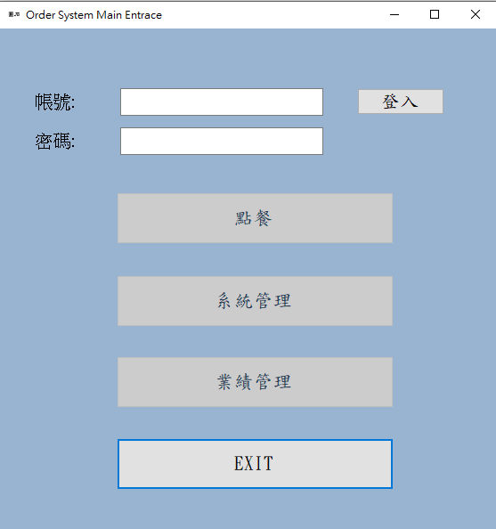
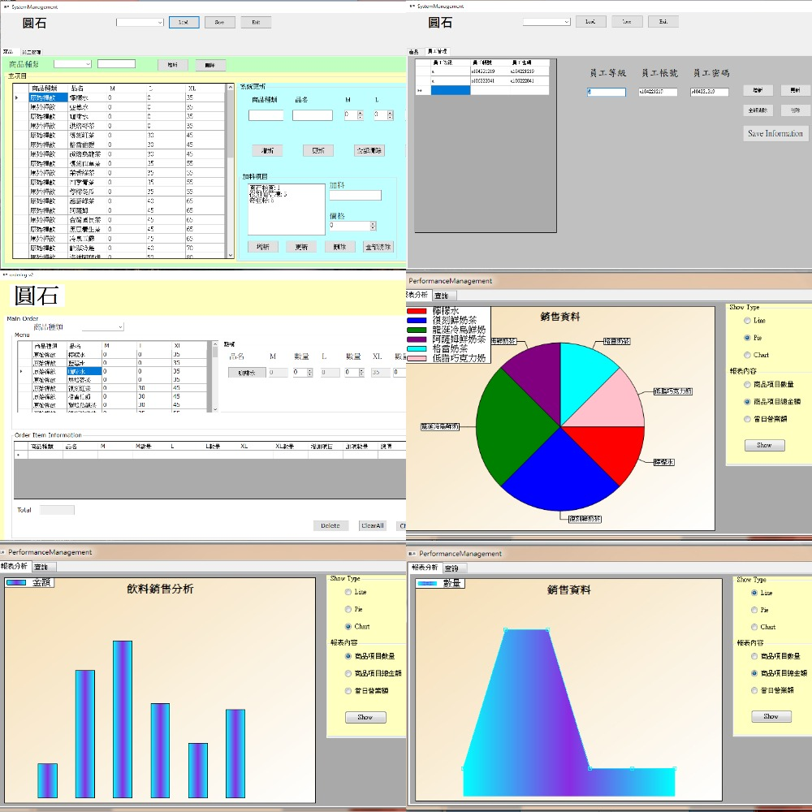
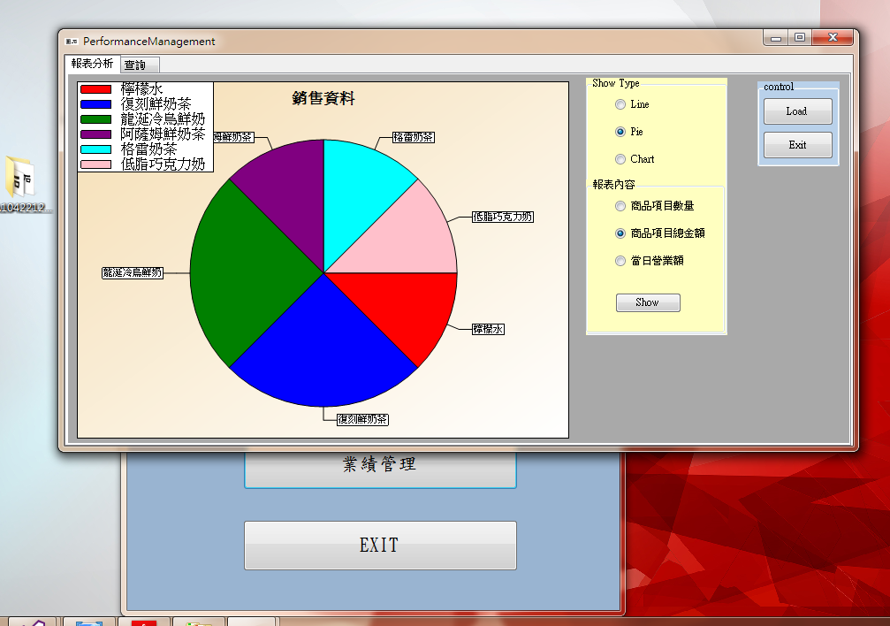
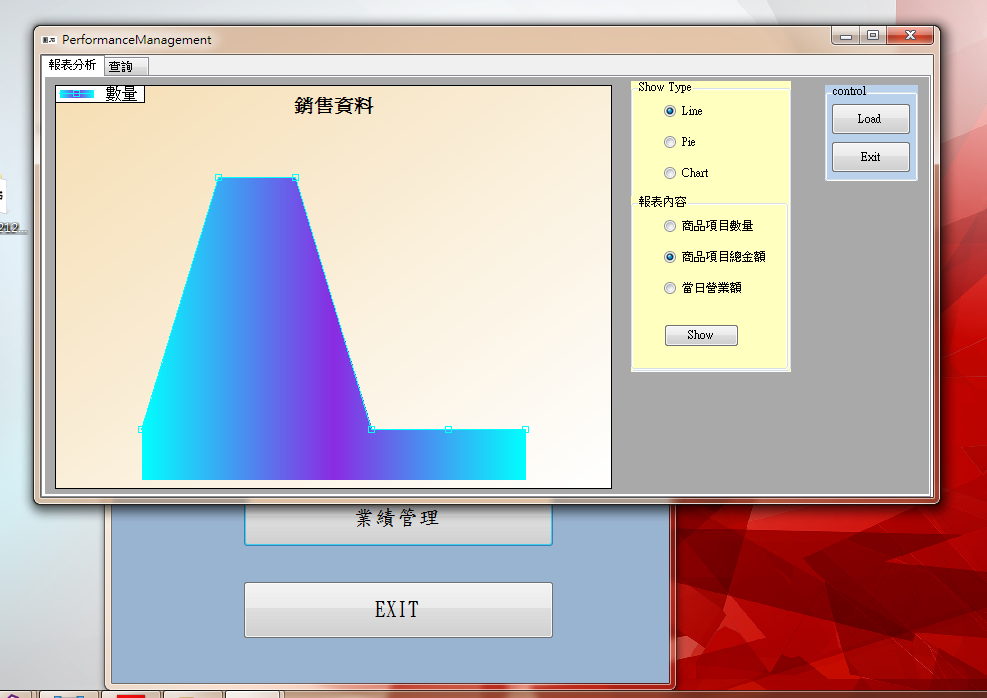
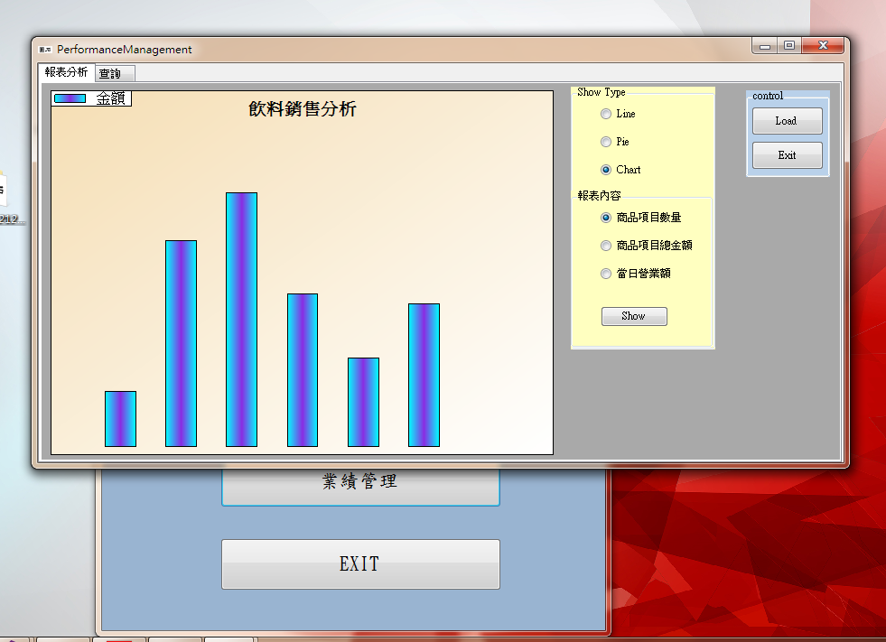

# 飲料點餐與銷售管理系統（C# Windows Forms）

這是一個大學程式設計課程的個人實作作品，以 C# Windows Forms 開發桌面飲料點餐系統，包含點餐介面、菜單與員工資料管理，以及歷史銷售紀錄讀取與查詢畫面。程式碼由作者獨立完成；當時雖有一位組員，主要協助簡報與文件整理，並非共同撰寫核心程式。

## 專案背景與個人貢獻

作者當時已轉學、轉系，於大三返回修讀大一程式設計課程，並在課程中完成此點餐系統。依作者回憶，課程成績為 98 分，為班上第二組完成度較高的作品。專案的核心程式設計由作者個人完成；組員主要協助簡報與文件，不將程式開發描述為團隊共同成果。

## 功能範圍

- **飲料點餐：** 依品項選擇 M／L／XL 尺寸與數量，計算品項小計及訂單總額。
- **加料選擇：** 支援加料品項與數量，將加料金額納入小計。
- **訂單操作：** 將品項加入訂單清單、刪除選取項目、清空訂單及輸出交易紀錄。
- **菜單管理：** 維護飲料分類、品項名稱、各尺寸價格及加料資料。
- **員工資料管理：** 以文字檔讀取與保存員工資料欄位。
- **銷售紀錄查詢：** 讀取歷史交易文字檔，嘗試呈現品項及銷售分析資訊。

## 技術

- C#
- Windows Forms
- .NET Framework 4.5.2
- Object-oriented data models
- DataGridView、NumericUpDown、OpenFileDialog、SaveFileDialog
- Text-file based data persistence
- ZedGraph（圖表元件引用）

## 專案結構

- `MainEntrace`：主畫面與功能入口。
- `ordering_v2`：點餐流程。
- `SystemManagement`：菜單、加料及員工資料管理。
- `PerformanceManagement`：歷史交易讀取及銷售查詢／圖表畫面。
- `data.cs`：帳號、品項、分類、加料及交易資料模型。
- `dataIo.cs`：文字檔讀取與交易資料解析。

## 重要限制

- 本專案是早期 Windows 桌面程式，使用 .NET Framework 4.5.2 與舊版 Visual Studio 專案格式；未在目前環境重新建置或測試。
- 主畫面的登入按鈕目前只檢查帳號與密碼欄位是否非空，沒有實際驗證帳密；不能描述為完整的身分驗證功能。
- 銷售圖表相關方法有建立圖表設定與資料陣列的程式碼，但顯示按鈕及部分繪圖流程尚未完成，不能宣稱銷售圖表已完整運作。
- 交易紀錄採自訂文字格式；程式中的 CSV 選項不等同於完整標準 CSV 匯出流程。
- 原始員工資料檔中的測試帳號與密碼已替換成示範佔位值。Git 歷史未重寫，舊 commit 仍可能保留原始內容。
- Repository 保留部分 Visual Studio 暫存檔、編譯輸出及歷史測試資料，本次未刪除這些檔案。

## 技術回顧

完整的資料模型、點餐流程、檔案格式及實作限制，請參閱 [PROJECT_RETROSPECTIVE.md](PROJECT_RETROSPECTIVE.md)。

## 歷史畫面

